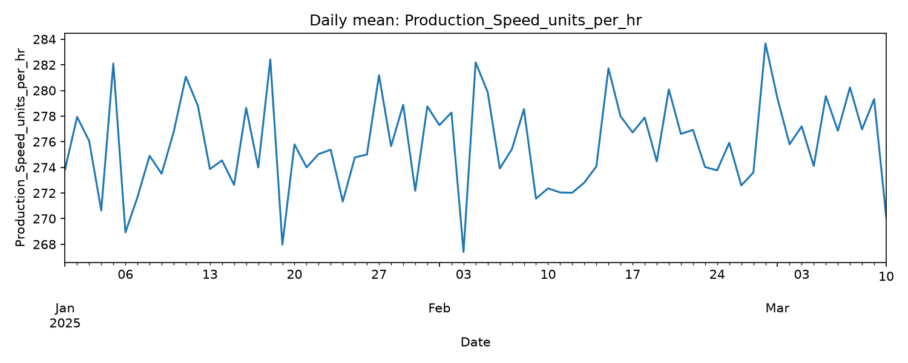
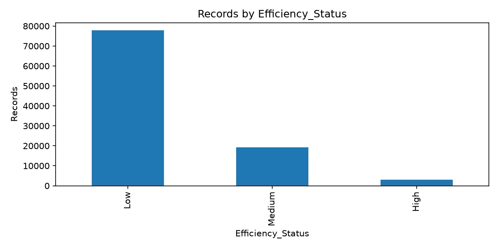
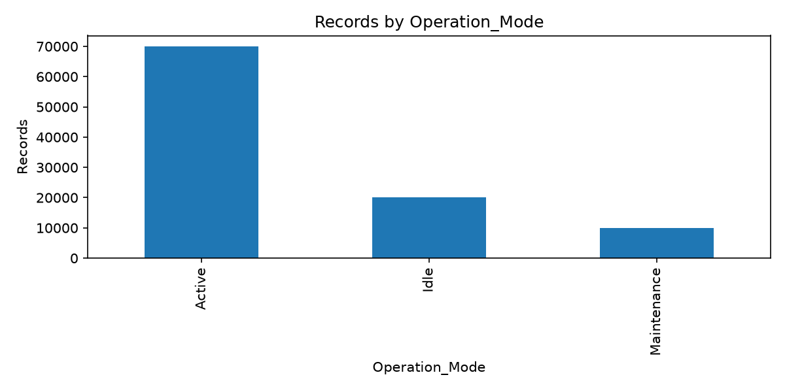
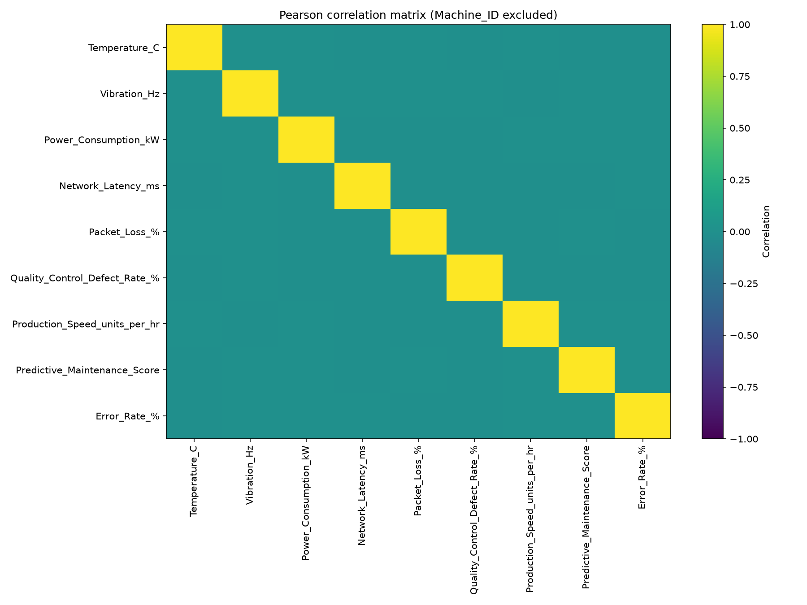
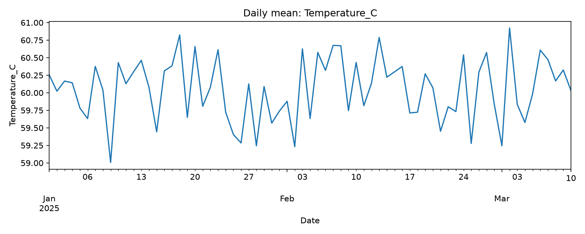
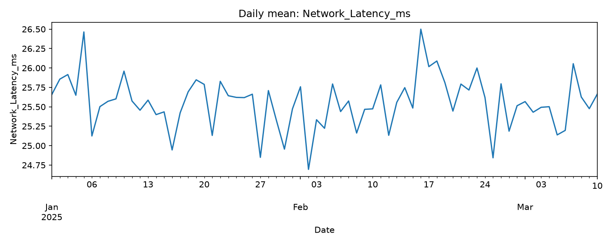

# Manufacturing Process Health and Operational Efficiency Analysis
## An Exploratory Study of a Supplied Smart Factory Dataset

**Project:** Unified Mentor Internship  
**Dataset:** `Thales_Group_Manufacturing.csv`  
**Study period:** 1 January 2025 – 10 March 2025  
**Analysis type:** Exploratory data analysis, statistical testing, forecasting evaluation and anomaly screening

---

## Abstract

Smart manufacturing environments generate operational data from machines, production processes, quality measurements and communication systems. Analysing these data can help identify operational patterns, evaluate process consistency and investigate unusual observations.

This study examines a supplied manufacturing dataset containing 100,000 records, 50 machines and three operation modes. The dataset includes production speed, temperature, vibration, power consumption, network latency, packet loss, defect rate, error rate and a predictive maintenance score.

The analysis covers data validation, exploratory data analysis, machine-level sensor variability, production and quality relationships, operation-mode comparisons, time-based trends, production forecasting and statistical anomaly detection.

The forecasting experiments evaluated global-mean, machine-mean and persistence baselines, followed by Ridge Regression and Random Forest models using current and historical features. None of the machine-learning models consistently outperformed the simple mean baselines on the chronological test sets. This indicates that the available features did not provide sufficient predictive information for reliable production-speed forecasting under the evaluated approach.

Anomaly screening used machine-specific and operation-mode-specific reference profiles. Isolation Forest identified 1,456 anomalies in the reference period and 1,141 in the evaluation period. The corresponding anomaly rates were 2.082% and 3.794%. However, flagged observations did not exhibit higher average defect or error rates in the available comparisons.

The findings demonstrate the importance of data validation, baseline comparisons and cautious interpretation in manufacturing analytics. The anomaly results should be treated as statistical screening signals, not confirmed equipment failures. Dataset provenance, engineering thresholds and the operational meaning of supplied fields require further verification.

**Keywords:** Smart Manufacturing, Manufacturing Analytics, Operational Efficiency, Exploratory Data Analysis, Machine Learning, Forecasting, Isolation Forest, Anomaly Detection, Predictive Maintenance

---

## 1. Introduction

Manufacturing operations involve multiple interacting factors, including machine condition, production speed, environmental measurements, network performance and product quality. Monitoring these factors can help organisations understand operational variation and identify observations that require further investigation.

Machine-learning methods are increasingly used in manufacturing analytics for forecasting, classification, anomaly detection and predictive maintenance. However, model performance depends on the quality of the underlying data, the reliability of target variables and the presence of meaningful relationships between input features and operational outcomes.

A model that produces predictions is not necessarily useful. Its performance must be compared with appropriate baselines, and its outputs must be interpreted in the context of the data-generating process.

This project investigates a supplied dataset attributed in the internship materials to Thales Group. The analysis focuses on understanding the dataset, examining machine and production behaviour, testing whether production speed can be forecast from available features, and screening observations for unusual patterns.

The study does not independently verify that the dataset originated from an operational Thales factory or that it represents a live 6G-enabled manufacturing deployment. Therefore, the work is framed as an exploratory analysis of a supplied smart-factory dataset.

### 1.1 Problem Statement

Manufacturing datasets can contain large volumes of sensor and operational measurements. Without systematic analysis, it may be difficult to determine:

- Whether the dataset is complete and internally consistent.
- How machine-level sensor measurements vary.
- Whether operation modes are associated with measurable production or quality differences.
- Whether available measurements provide useful information for forecasting production speed.
- Whether unusual observations can be identified using statistical anomaly-detection techniques.
- Whether detected anomalies correspond to worse quality outcomes.

### 1.2 Objectives

The objectives are:

1. Validate the supplied dataset and investigate data-quality issues.
2. Analyse machine-level sensor behaviour and variability.
3. Examine production, defect and error-rate relationships.
4. Compare operational metrics across operation modes.
5. Investigate daily trends and temporal behaviour.
6. Evaluate production-speed forecasting against simple baselines.
7. Apply machine-specific anomaly screening.
8. Develop an interactive dashboard for exploring the analysis results.
9. Document limitations and provide recommendations for future work.

---

## 2. Dataset Description

### 2.1 Dataset Overview

The dataset used in this project is named `Thales_Group_Manufacturing.csv`.

It contains:

| Property | Value |
|---|---:|
| Total records | 100,000 |
| Total columns | 14 |
| Unique machines | 50 |
| Operation modes | 3 |
| Efficiency status categories | 3 |
| Study start | 2025-01-01 |
| Study end | 2025-03-10 10:39 |
| Missing cells | 0 |
| Fully duplicated rows | 0 |

The three operation modes are Active, Idle and Maintenance.

### 2.2 Dataset Variables

The dataset contains the following variables:

| Variable | Description |
|---|---|
| Date | Observation date |
| Timestamp | Observation time |
| Machine_ID | Machine identifier |
| Operation_Mode | Machine operating mode |
| Temperature_C | Temperature measurement in degrees Celsius |
| Vibration_Hz | Vibration measurement |
| Power_Consumption_kW | Power consumption |
| Network_Latency_ms | Network latency |
| Packet_Loss_% | Network packet loss |
| Quality_Control_Defect_Rate_% | Quality-control defect rate |
| Production_Speed_units_per_hr | Production speed |
| Predictive_Maintenance_Score | Supplied maintenance score |
| Error_Rate_% | Error rate |
| Efficiency_Status | Supplied efficiency category |

The meanings and engineering units above follow the supplied column names and project dataset. They should not be interpreted as independently verified sensor specifications.

### 2.3 Descriptive Statistics

The following table summarises the numeric variables. The machine-readable source for these descriptive statistics is **Table 1** in the supporting evidence index.

| Variable | Mean | Standard deviation | Minimum | Maximum |
|---|---:|---:|---:|---:|
| Temperature (°C) | 60.041 | 17.323 | 30.000 | 89.999 |
| Vibration | 2.550 | 1.414 | 0.100 | 5.000 |
| Power (kW) | 5.746 | 2.451 | 1.500 | 10.000 |
| Network latency (ms) | 25.556 | 14.121 | 1.000 | 50.000 |
| Packet loss (%) | 2.493 | 1.443 | 0.000 | 5.000 |
| Defect rate (%) | 5.009 | 2.884 | 0.000 | 10.000 |
| Production speed (units/hr) | 275.916 | 130.097 | 50.000 | 499.997 |
| Maintenance score | 0.499 | 0.289 | 0.000 | 1.000 |
| Error rate (%) | 7.504 | 4.336 | 0.000 | 15.000 |

All listed numeric variables contain 100,000 observations.

The wide ranges and distributions are useful for describing the supplied dataset. However, they should not be interpreted as validated engineering operating ranges. Authoritative machine specifications and operating limits were not available for this study.

---

## 3. Data Validation and Preprocessing

### 3.1 Data Validation

The initial validation process examined:

- Dataset dimensions.
- Missing values.
- Fully duplicated rows.
- Machine identifiers.
- Operation modes.
- Date and timestamp validity.
- Duplicate machine/timestamp combinations.

The validation found no missing cells, no fully duplicated rows and no invalid combined timestamps.

However, 28 duplicate machine/timestamp keys beyond their first occurrences were identified. In total, 56 rows participated in duplicate machine/timestamp groups.

These records were flagged rather than automatically removed from the main analytical dataset.

### 3.2 Timestamp Processing

The date and time fields were combined into a single datetime variable for temporal analysis.

The combined timestamps covered the period from 1 January 2025 to 10 March 2025 at 10:39.

### 3.3 Data-Quality Limitations

Although the dataset passed several structural checks, structural validity does not establish that the measurements are physically realistic.

The analysis did not have authoritative documentation for:

- Machine-specific sensor limits.
- Expected sensor sampling frequencies.
- The provenance of the efficiency-status labels.
- The formula used to calculate the predictive-maintenance score.
- Whether the data represents actual factory operations or simulated observations.

These limitations affect the strength of any operational conclusions.

---

## 4. Methodology

The project was divided into six analytical areas.

### 4.1 Exploratory Data Analysis

Exploratory analysis was performed to understand:

- Numeric-variable distributions.
- Machine-level production behaviour.
- Operation-mode distributions.
- Correlations between numeric variables.
- Daily production and quality measurements.

Descriptive statistics, correlation analysis and visualisations were used to identify patterns and potential relationships.

### 4.2 Machine Health and Sensor Stability

Machine-level analysis examined temperature, vibration and power-consumption measurements.

For each machine and sensor, descriptive statistics and relative variability measures were calculated.

The coefficient of variation was used to compare relative variation:

\[
CV = \frac{\text{Standard Deviation}}{\text{Mean}} \times 100
\]

The analysis also investigated daily machine-level averages and descriptive linear trends over time.

These measures describe variation. They are not validated indicators of equipment failure or safety.

### 4.3 Production and Quality Analysis

Production speed, defect rate and error rate were analysed overall and across operation modes.

Correlation coefficients were used to examine linear associations.

Operation-mode comparisons used the Friedman test, with machines treated as blocks. This approach compared machine-level averages across the three modes.

The analysis also used Benjamini-Hochberg adjustment for the three primary operation-mode tests.

### 4.4 Production Forecasting

Production speed was selected as the forecasting target.

Three forecast horizons were evaluated:

- 30 minutes.
- 60 minutes.
- 120 minutes.

Forecast pairs were constructed by matching future observations to source observations within a tolerance of ±15 minutes.

Only future observations occurring after the source observation were retained. Duplicate machine/timestamp groups were excluded from the forecasting dataset.

Chronological splits were used:

- Training: earliest 70% of unique source timestamps.
- Validation: next 15%.
- Testing: final 15%.

The evaluation included:

- Global-mean baseline.
- Machine-mean baseline.
- Persistence baseline.
- Ridge Regression.
- Random Forest Regression.

A second experiment introduced historical features, including previous observations and rolling-window statistics.

Performance was evaluated using:

\[
MAE = \frac{1}{n}\sum_{i=1}^{n}|y_i-\hat{y}_i|
\]

\[
RMSE = \sqrt{\frac{1}{n}\sum_{i=1}^{n}(y_i-\hat{y}_i)^2}
\]

The coefficient of determination, \(R^2\), was also recorded.

### 4.5 Anomaly Detection

Anomaly screening used two approaches.

**Robust statistical screening**

Machine-specific and operation-mode-specific reference profiles were constructed using medians and interquartile ranges. Robust deviations were evaluated using a threshold of 3.5.

**Isolation Forest**

Isolation Forest models were fitted separately for machine and operation-mode groups using the reference period. The configured contamination parameter was 0.02.

The first 70% of observations in each machine/mode group were used as the reference period, with the remaining observations used as the evaluation period.

The following variables were used as anomaly-detection features:

- Production speed.
- Temperature.
- Vibration.
- Power consumption.
- Network latency.
- Packet loss.
- Predictive-maintenance score.

Defect rate and error rate were excluded from the anomaly features so that their relationship with the resulting anomaly labels could be examined separately.

Anomaly labels indicate statistical unusualness under the fitted models. They do not confirm equipment failure.

---

## 5. Results and Discussion

### 5.1 Machine-Level Sensor Analysis

Machine-level analysis covered 50 machines and three sensor variables, producing 150 machine-sensor combinations.

The machine-specific IQR screening did not identify observations outside the applied 1.5-IQR limits.

This does not establish that all machines were healthy. It only means that the selected screening rule did not flag observations under the chosen machine-specific distributions.

The highest relative variability examples were:

| Sensor | Machine | Approximate CV |
|---|---:|---:|
| Temperature | 38 | 29.5% |
| Temperature | 2 | 29.5% |
| Temperature | 7 | 29.4% |
| Vibration | 39 | 57.3% |
| Vibration | 42 | 57.0% |
| Vibration | 8 | 56.2% |
| Power | 9 | 43.8% |
| Power | 37 | 43.5% |
| Power | 24 | 43.4% |

These results identify machines with relatively variable measurements in the supplied dataset. They do not establish that those machines experienced faults.

Daily sensor-stability analysis found that all 50 machines had 69 valid observation days.

The highest daily variability examples were:

| Sensor | Machine | Daily CV |
|---|---:|---:|
| Temperature | 16 | 6.58% |
| Vibration | 11 | 12.41% |
| Power | 40 | 9.72% |

The strongest descriptive daily linear trends included:

| Sensor | Machine | Trend per observation day |
|---|---:|---:|
| Temperature | 20 | +0.053892 |
| Vibration | 46 | -0.005594 |
| Power | 18 | +0.005403 |

These trends were descriptive and were not independently established as statistically significant deterioration or improvement.

### 5.2 Production and Quality Relationships

The operation-mode summaries were:

| Operation mode | Records | Mean production speed | Mean error rate | Mean defect rate |
|---|---:|---:|---:|---:|
| Active | 70,054 | 276.199 | 7.494% | 5.009% |
| Idle | 20,057 | 274.126 | 7.523% | 5.010% |
| Maintenance | 9,889 | 277.544 | 7.537% | 5.001% |

The differences in the reported means were small.

Overall correlations were also negligible; the complete correlation output is provided in **Table 2**. The assignment-specific sensor comparisons are detailed in Section 5.2.1.

| Variable pair | Pearson correlation |
|---|---:|
| Production speed and error rate | 0.00607 |
| Production speed and defect rate | -0.00494 |
| Error rate and defect rate | -0.00149 |

These results indicate that the measured variables did not exhibit meaningful linear associations in the pooled dataset.

A weak correlation does not rule out nonlinear relationships. It does, however, mean that simple linear relationships were not evident in these measurements.

### 5.2.1 Assignment-Specific Cross-Metric Diagnostics

The assignment specifically requests temperature-versus-defect, vibration-versus-error and power-consumption-versus-efficiency diagnostics. These were checked against the packaged raw CSV using Pearson and Spearman association for continuous pairs and descriptive group means for the supplied efficiency categories.

| Requested comparison | Statistic / descriptive result | Interpretation |
|---|---:|---|
| Temperature vs defect rate | Pearson r = -0.0022; Spearman ρ = -0.0022 | No meaningful pooled monotonic or linear association is evident. |
| Vibration vs error rate | Pearson r = 0.0046; Spearman ρ = 0.0046 | No meaningful pooled monotonic or linear association is evident. |
| Power vs production speed | Pearson r = 0.0020 | No meaningful pooled linear association is evident. |
| Mean power by supplied efficiency label | High = 5.718 kW; Medium = 5.762 kW; Low = 5.743 kW | Group means are close; the supplied efficiency label is not independent ground truth. |

These are pooled descriptive comparisons. They may conceal machine-specific, mode-specific or nonlinear patterns, and they do not establish causation. Because `Efficiency_Status` is supplied and its derivation is undocumented, the power-by-efficiency comparison is descriptive only. The full numeric correlation evidence is available in [Table 2](tables/eda_numeric_correlations.csv).

### 5.3 Operation-Mode Statistical Tests

The Friedman tests compared machine-level averages across Active, Idle and Maintenance modes. The full test output is provided in **Table 5**.

| Metric | Friedman statistic | p-value | Kendall's W | Adjusted p-value |
|---|---:|---:|---:|---:|
| Production speed | 3.00 | 0.223130 | 0.0300 | 0.669390 |
| Error rate | 0.84 | 0.657047 | 0.0084 | 0.869358 |
| Defect rate | 0.28 | 0.869358 | 0.0028 | 0.869358 |

None of the three tests was statistically significant at the 0.05 level after adjustment.

The Kendall's W values were also very small, indicating weak differences in the machine-level rankings across modes.

The results do not provide evidence of meaningful operation-mode differences for these three metrics in the supplied dataset.

### 5.4 Daily Production and Quality Trends

Daily averages over the 69-day observation period are shown below; the complete daily trend output is provided in **Table 4**:

| Metric | Daily mean | Daily standard deviation |
|---|---:|---:|
| Production speed | 275.820 | 3.573 |
| Error rate | 7.503% | 0.107 |
| Defect rate | 5.008% | 0.084 |

Descriptive linear trend tests against daily observation order produced:

| Metric | Trend per day | p-value | R² |
|---|---:|---:|---:|
| Production speed | +0.025934 | 0.232469 | 0.021210 |
| Error rate | -0.000558 | 0.391022 | 0.011003 |
| Defect rate | -0.000916 | 0.070470 | 0.048010 |

None of the trends was statistically significant at the 0.05 level.

The defect-rate p-value was 0.070470, which is above the selected significance threshold.

These results do not establish a sustained improvement or deterioration in production quality.

### 5.4.1 Daily Trend Figures

The following figures provide static visual evidence for the daily time-series analysis. Each image is stored in the final figure folder and is referenced using a path relative to this paper.

**Figure 1.** Daily mean production speed across the observation period.

**Figure 2.** Daily mean quality-control defect rate.

**Figure 3.** Daily mean operational error rate.

### 5.5 Production Forecasting Results

The forecasting datasets contained:

| Forecast horizon | Valid pairs | Machines | Median actual lead |
|---|---:|---:|---:|
| 30 minutes | 37,887 | 50 | 30 minutes |
| 60 minutes | 37,211 | 50 | 60 minutes |
| 120 minutes | 37,030 | 50 | 120 minutes |

The final dataset-quality checks found no reused target groups, repeated source groups, future-order violations or tolerance violations.

The actual lead-time ranges were 15–45 minutes, 45–75 minutes and 105–135 minutes respectively. These ranges reflect the ±15-minute matching tolerance.

#### Baseline Performance

Test-set results:

| Horizon | Baseline | MAE | RMSE | R² |
|---|---|---:|---:|---:|
| 30 min | Global mean | 112.893 | 130.097 | approximately 0 |
| 30 min | Machine mean | 112.849 | 130.035 | 0.000943 |
| 30 min | Persistence | 151.866 | 186.375 | -1.052337 |
| 60 min | Global mean | 113.133 | 130.397 | approximately 0 |
| 60 min | Machine mean | 113.171 | 130.476 | -0.001216 |
| 60 min | Persistence | 151.690 | 185.763 | -1.029479 |
| 120 min | Global mean | 113.314 | 130.311 | approximately 0 |
| 120 min | Machine mean | 113.425 | 130.431 | -0.001922 |
| 120 min | Persistence | 150.498 | 185.113 | -1.018093 |

The persistence baseline performed poorly, while global and machine means produced similar test performance.

#### Historical-Feature Model Performance

The historical-feature experiment introduced previous observations and rolling-window statistics.

Test results:

| Horizon | Model | MAE | RMSE | R² |
|---|---|---:|---:|---:|
| 30 min | Ridge | 113.031 | 130.287 | -0.002940 |
| 30 min | Random Forest | 113.380 | 130.740 | -0.009918 |
| 60 min | Ridge | 113.355 | 130.703 | -0.004705 |
| 60 min | Random Forest | 113.375 | 130.843 | -0.006858 |
| 120 min | Ridge | 113.415 | 130.393 | -0.001330 |
| 120 min | Random Forest | 113.426 | 130.495 | -0.002895 |

Neither Ridge nor Random Forest outperformed the strongest simple baseline at any evaluated horizon.

The Random Forest models showed a substantial gap between training and validation/test performance. This is evidence of poor generalisation under the chronological evaluation.

Adding historical features did not solve the forecasting problem.

The correct conclusion is not that machine learning is universally unsuitable for manufacturing forecasting. It is that the available dataset and evaluated features did not support useful production-speed forecasting with these models and validation procedures.

### 5.6 Anomaly Detection Results

The anomaly-detection dataset was divided into:

| Period | Records |
|---|---:|
| Reference | 69,929 |
| Evaluation | 30,071 |
| Total | 100,000 |

#### Robust Statistical Screening

The robust statistical detector identified zero anomalies in both periods.

This result should be interpreted in the context of the feature distributions and the selected threshold. It does not prove that the dataset contains no unusual or problematic observations.

#### Isolation Forest

| Period | Records | Anomalies | Anomaly rate |
|---|---:|---:|---:|
| Reference | 69,929 | 1,456 | 2.082% |
| Evaluation | 30,071 | 1,141 | 3.794% |
| Total | 100,000 | 2,597 | 2.597% |

The evaluation-period anomaly rate was 1.712 percentage points higher than the reference-period rate.

This is a change in the proportion of observations flagged by the model. It is not, by itself, evidence of machine deterioration.

The reference-period rate is influenced by the configured 2% contamination setting. The evaluation rate is not fixed to that setting.

#### Anomaly Rates by Operation Mode

| Operation mode | Records | Anomalies | Anomaly rate |
|---|---:|---:|---:|
| Active | 70,054 | 1,585 | 2.263% |
| Idle | 20,057 | 619 | 3.086% |
| Maintenance | 9,889 | 393 | 3.974% |

Maintenance observations had the highest overall anomaly rate, followed by Idle and Active observations.

However, the Isolation Forest models were fitted separately by machine and operation mode. These rates should not be interpreted as directly calibrated measures of anomaly severity across modes.

#### Machine-Level Anomaly Patterns

The highest machine-level anomaly rates included:

| Machine | Anomalies | Records | Anomaly rate |
|---|---:|---:|---:|
| 47 | 63 | 2,001 | 3.148% |
| 44 | 64 | 2,054 | 3.116% |
| 34 | 60 | 1,948 | 3.080% |
| 11 | 59 | 1,951 | 3.024% |
| 27 | 59 | 1,957 | 3.015% |

These are screening priorities for further investigation, not a ranking of confirmed machine failures.

Some machine-mode combinations had higher rates. For example, Machine 12 in Maintenance mode had 14 flagged observations among 198 records, a rate of 7.071%.

#### Anomaly Association with Quality

The evaluation-period quality comparison (see **Table 12**) was:

| Outcome | Flagged mean | Normal mean | Difference |
|---|---:|---:|---:|
| Defect rate | 4.970% | 4.998% | -0.028 percentage points |
| Error rate | 7.391% | 7.493% | -0.102 percentage points |

The flagged observations did not have higher average defect or error rates in this comparison.

A further within-machine/mode comparison produced weighted differences of approximately:

- Defect rate: -0.027 percentage points.
- Error rate: -0.098 percentage points.

The direction of the within-group differences was mixed.

Consequently, this analysis does not demonstrate that Isolation Forest anomalies correspond to worse product quality.

The results also do not establish that flagged observations are harmless. The detector identifies unusual feature combinations, while the quality comparison examines only two supplied outcome measurements.

### 5.7 Observation-Frequency Investigation

The dataset contained an unusual increase in the number of observations on 1 March 2025.

The daily record count was:

| Date | Records |
|---|---:|
| 28 February 2025 | 1,440 |
| 1 March 2025 | 2,880 |
| 2 March 2025 | 1,440 |

The higher count on 1 March was distributed across all 50 machines.

The median machine-level timestamp interval was approximately 17 minutes on 1 March, compared with approximately 34–35 minutes on the adjacent days.

Only 56 rows in the complete dataset participated in duplicate machine/timestamp groups. The increased 1 March count therefore cannot be explained simply by those duplicate groups.

The available data supports the conclusion that observation frequency or allocation changed on 1 March. It does not establish why this happened.

The date was retained in the analysis. Daily anomaly rates are more suitable for comparisons than raw anomaly counts when record frequency differs.

---

### 5.8 Visual Evidence for Machine, Sensor and Network Diagnostics

**Figure 4.** Record distribution across the supplied High, Medium and Low efficiency categories. These categories are not independently validated labels.

**Figure 5.** Record distribution across Active, Idle and Maintenance operation modes.

**Figure 6.** Pearson correlation heatmap for numeric dataset variables.

**Figure 7.** Daily mean temperature measurement.

**Figure 8.** Daily mean recorded network latency.

**Figure 9.** Daily mean recorded packet-loss percentage.

## 6. Dashboard Development

An interactive Streamlit dashboard was developed to make the analysis accessible.

The dashboard includes the following analytical areas:

1. **Overview:** high-level dataset and operational metrics.
2. **Machine Analysis:** machine-level production and sensor comparisons.
3. **Quality Analysis:** defect and error-rate summaries.
4. **Sensor and Network Analysis:** sensor measurements and communication metrics.
5. **Anomaly Detection:** anomaly rates, reference/evaluation comparisons and machine-mode summaries.
6. **Data Quality:** dataset limitations, validation findings and interpretation cautions.

The dashboard supports interactive filtering and visual exploration.

Its purpose is analytical transparency. It should not be interpreted as an industrial control system or an automated maintenance decision platform.

---

## 7. Limitations

The findings must be considered in light of the following limitations.

### 7.1 Dataset Provenance

The dataset was supplied for the internship and attributed in the project materials to Thales Group. Its origin and collection process were not independently verified.

The analysis cannot establish that it represents actual Thales manufacturing operations.

### 7.2 6G Deployment

The dataset includes network latency and packet-loss fields. These variables do not establish that the measurements were collected from a live 6G network.

No deployment documentation or network architecture evidence was available.

### 7.3 Engineering Thresholds

The analysis did not have machine-specific engineering limits or authoritative sensor specifications.

Statistical outliers and anomaly labels must not be treated as engineering fault thresholds.

### 7.4 Efficiency and Maintenance Labels

The supplied `Efficiency_Status` field could be reconstructed exactly using a candidate rule based on production speed and error rate:

- High: production speed at least 400 and error rate at most 2.
- Medium: production speed at least 200, error rate at most 5, and either error rate below 5 or production speed below 400.
- Low: remaining observations.

Although the candidate rule achieved 100% agreement with the supplied label, its original provenance was not established. The rule was investigated using the same dataset and is not an independently validated factory standard.

The supplied predictive-maintenance score also lacks documented provenance.

Therefore, the efficiency label was not treated as an independently verified target for a successful machine-health prediction model.

### 7.5 Forecasting Limitations

The forecasting experiments used a chronological split and a limited set of current and historical features.

The tested models did not outperform simple mean baselines. Other modelling approaches, additional process information or different target definitions might produce different results, but such improvements have not been demonstrated here.

### 7.6 Anomaly Detection Limitations

Isolation Forest is an unsupervised statistical screening method. The analysis did not have confirmed failure events or maintenance records for validating detected anomalies.

The configured contamination rate also influences the reference-period anomaly count.

The flagged observations cannot be treated as confirmed faults.

### 7.7 Statistical Limitations

Some exploratory correlation and trend analyses used ordinary statistical tests on repeated observations. Dependence between observations can affect conventional p-values.

The study period is also relatively short for making long-term claims about machine deterioration or operational improvement.

---

## 8. Recommendations

Based on the results and limitations, the following steps are recommended.

### 8.1 Improve Data Documentation

Obtain authoritative documentation for:

- Dataset origin and collection procedure.
- Machine identifiers and equipment specifications.
- Sensor units and sampling frequencies.
- Operation-mode definitions.
- Efficiency-status calculation.
- Predictive-maintenance score calculation.

### 8.2 Validate Engineering Limits

Work with manufacturing or maintenance specialists to establish machine-specific acceptable operating ranges.

Use those limits alongside statistical screening rather than replacing engineering validation with generic thresholds.

### 8.3 Investigate Anomaly Patterns

Use the Isolation Forest output to prioritise observations for review.

Compare flagged records with maintenance logs, machine events, production incidents and quality-control records when those sources become available.

### 8.4 Improve Forecasting Data

Before attempting more complex forecasting models, investigate:

- Whether timestamps represent actual measurement times.
- Whether the sampling process is consistent.
- Whether production speed is recorded at sufficient resolution.
- Whether machine-specific process variables are available.
- Whether additional historical context is predictive.

Evaluate any future model against the same chronological baselines.

### 8.5 Validate Maintenance and Quality Outcomes

A future predictive-maintenance study should use verified maintenance events, failure records or technician-confirmed conditions.

Anomaly detection should be evaluated against those outcomes before being used to support operational decisions.

### 8.6 Extend the Monitoring System

The Streamlit dashboard can be extended with:

- Verified engineering thresholds.
- Confirmed maintenance events.
- Alert review and acknowledgement.
- Historical machine-condition tracking.
- Model-performance monitoring.
- Data-quality monitoring.

Any alerting functionality should include human review and clear uncertainty information.

---

## 9. Conclusion

This project conducted an exploratory analysis of a supplied manufacturing dataset containing 100,000 records across 50 machines and three operation modes.

The dataset passed several structural validation checks, although duplicate machine/timestamp keys and an unusual observation-frequency change required investigation.

Machine-level sensor analysis described variation across machines but did not establish equipment failures. Production and quality variables showed negligible pooled linear correlations, while the Friedman tests did not identify statistically significant operation-mode differences in production speed, error rate or defect rate.

Production forecasting was attempted at 30-, 60- and 120-minute horizons. Ridge Regression and Random Forest models, including historical features, did not outperform the simple mean baselines on the chronological test sets. The forecasting experiments therefore do not support presenting the trained models as successful production predictors.

Isolation Forest identified 2,597 statistical anomalies across the dataset. Its evaluation-period anomaly rate was higher than the reference-period rate. However, flagged observations did not exhibit higher average defect or error rates in the available comparisons. These results support further investigation, not automatic fault diagnosis.

The main outcome of this project is a documented analytical workflow, a set of reproducible exploratory and statistical analyses, forecasting experiments with baseline comparisons, an anomaly-screening pipeline and an interactive dashboard.

The study also demonstrates an important principle in applied machine learning: model complexity cannot compensate for weak predictive information, uncertain target definitions or insufficient data provenance.

Future work should prioritise verified operational data, engineering thresholds, confirmed maintenance outcomes and stronger validation before deploying predictive or automated maintenance decisions.

---

## 10. Reproducibility and Supporting Files

The project contains Python scripts, processed datasets, analysis reports, forecasting results, anomaly-detection outputs and a Streamlit dashboard.

Important supporting outputs include:

| Analysis area | Supporting output |
|---|---|
| Data validation | `reports/data_quality_summary.txt` |
| Numeric distributions | `reports/eda_numeric_summary.csv` |
| Machine sensor stability | `reports/deep_machine_sensor_summary.csv` |
| Operation-mode tests | `reports/operation_mode_friedman_tests.csv` |
| Production trends | `reports/daily_production_quality_trends.csv` |
| Forecast baseline metrics | `reports/forecast_baseline_metrics.csv` |
| Historical-feature model metrics | `reports/historical_feature_model_metrics.csv` |
| Forecast dataset quality | `reports/forecast_final_dataset_quality.csv` |
| Anomaly rates by period | `reports/anomaly_rates_by_period.csv` |
| Anomaly rates by operation mode | `reports/anomaly_rates_by_operation_mode.csv` |
| Machine anomaly rates | `reports/machine_anomaly_rates.csv` |
| Anomaly-quality comparison | `reports/anomaly_quality_association.csv` |
| Anomaly results | `data/processed/machine_anomaly_results.csv` |

The final submission should include the project source code, dashboard, documentation, selected figures and final report files.

---

### 10.1 Numbered Supporting Evidence Tables

The following numbered evidence index links the main reported results to the selected CSV files packaged with the submission. These CSVs are supplementary machine-readable outputs; the descriptive tables printed in the paper remain the primary reader-facing summaries.

- **Table 1.** Numeric descriptive statistics — [eda_numeric_summary.csv](tables/eda_numeric_summary.csv).
- **Table 2.** Numeric correlation matrix — [eda_numeric_correlations.csv](tables/eda_numeric_correlations.csv).
- **Table 3.** Production and quality metrics by operation mode — [eda_metrics_by_operation_mode.csv](tables/eda_metrics_by_operation_mode.csv).
- **Table 4.** Daily EDA trends — [eda_daily_trends.csv](tables/eda_daily_trends.csv).
- **Table 5.** Operation-mode Friedman tests — [operation_mode_friedman_tests.csv](tables/operation_mode_friedman_tests.csv).
- **Table 6.** Forecast baseline metrics — [forecast_baseline_metrics.csv](tables/forecast_baseline_metrics.csv).
- **Table 7.** Historical-feature model metrics — [historical_feature_model_metrics.csv](tables/historical_feature_model_metrics.csv).
- **Table 8.** Forecast dataset quality — [forecast_final_dataset_quality.csv](tables/forecast_final_dataset_quality.csv).
- **Table 9.** Anomaly rates by period — [anomaly_rates_by_period.csv](tables/anomaly_rates_by_period.csv).
- **Table 10.** Anomaly rates by operation mode — [anomaly_rates_by_operation_mode.csv](tables/anomaly_rates_by_operation_mode.csv).
- **Table 11.** Machine-level anomaly rates — [machine_anomaly_rates.csv](tables/machine_anomaly_rates.csv).
- **Table 12.** Anomaly/quality association — [anomaly_quality_association.csv](tables/anomaly_quality_association.csv).
- **Table 13.** Daily anomaly rates — [daily_anomaly_rates.csv](tables/daily_anomaly_rates.csv).
- **Table 14.** Duplicate machine/timestamp investigation — [duplicate_machine_timestamps.csv](tables/duplicate_machine_timestamps.csv).
- **Table 15.** Data distribution audit — [data_distribution_audit.csv](tables/data_distribution_audit.csv).
- **Table 16.** Efficiency-status counts — [eda_efficiency_status_counts.csv](tables/eda_efficiency_status_counts.csv).
- **Table 17.** Efficiency-label distribution audit — [label_audit_distribution.csv](tables/label_audit_distribution.csv).
- **Table 18.** Adjacent-day coverage around 1 March — [march_1_adjacent_day_coverage.csv](tables/march_1_adjacent_day_coverage.csv).

### 10.2 KPI Definitions and Dataset Results

The assignment requests a Machine Health Index, Average Production Speed, Defect Density Score, Error Frequency Index and Efficiency Distribution. The packaged analysis provides the following defensible interpretations:

| KPI | Operational definition used in this project | Full-dataset result |
|---|---|---:|
| Average Production Speed | Arithmetic mean of production speed | 275.916 units/hour |
| Defect Density Score | Production-weighted mean defect percentage: Σ(speed × defect %) / Σ(speed) | 5.002% |
| Error Frequency Index | Production-weighted mean error percentage: Σ(speed × error %) / Σ(speed) | 7.517% |
| Efficiency Distribution | Supplied label counts divided by all records | Low 77.825%; Medium 19.189%; High 2.986% |
| Machine Health Index | Not claimed as validated; exploratory sensor deviation percentile is reported instead | Not a validated health score |

The weighted defect and error percentages use production speed as a record weight. They do not represent observed defective-unit or error-event counts. The CSV does not provide unit-level defect counts, event counts, machine-specific engineering limits or confirmed failure outcomes. The dashboard's robust sensor-deviation percentile is therefore retained as an exploratory indicator rather than renamed as a validated Machine Health Index.

The dataset contains no shift identifier or supplied shift schedule; shift-based comparisons are not claimed. A time-of-day filter is available in the updated dashboard, but it does not by itself define organisational shifts.

## References and Documentation

No external research publications or authoritative factory specifications were independently used to establish the dataset's origin, engineering thresholds or 6G deployment status.

The methods described in this report are documented through the project's Python scripts and generated analysis outputs. Before formal academic submission, add the actual software-library versions from the project environment and any required institutional or internship references.